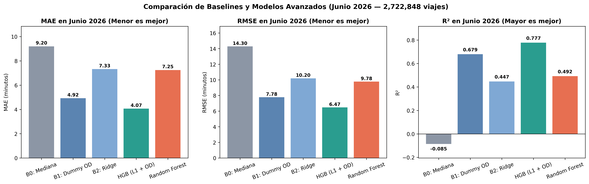
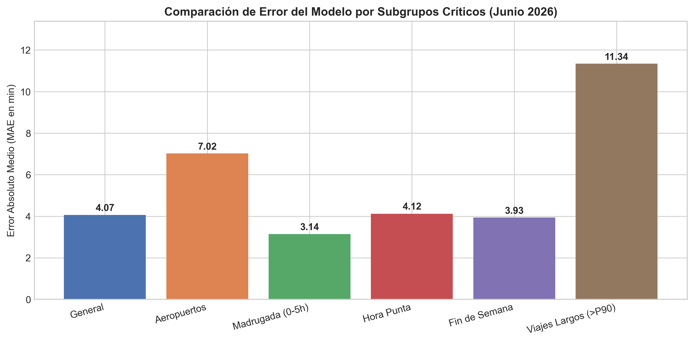
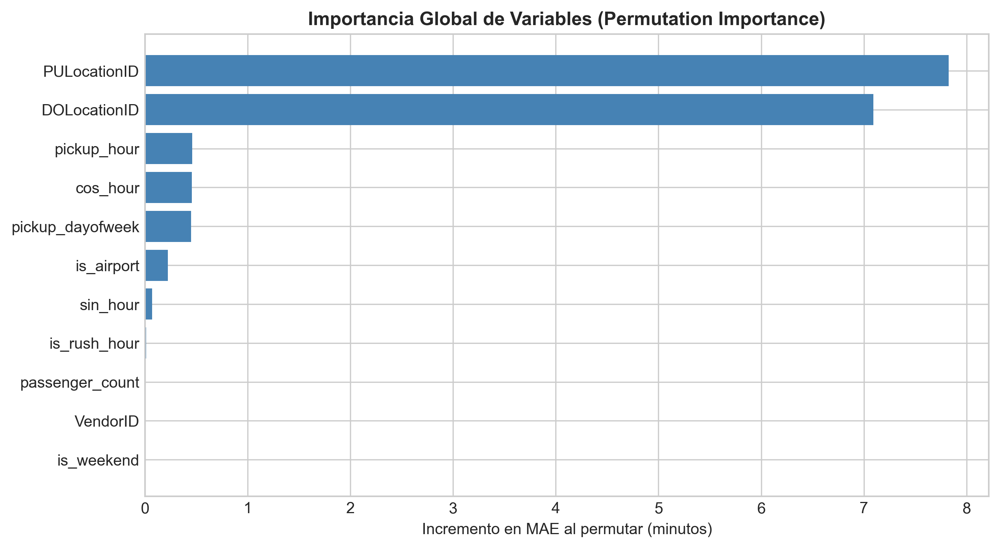

# Informe Técnico Final

## Proyecto de Machine Learning: Predicción de duración de viajes en NYC Yellow Taxi

### 1. Introducción

El proyecto desarrolla un modelo de Machine Learning para predecir la duración de los viajes de taxis amarillos (Yellow Taxi) de Nueva York, utilizando información histórica de los viajes registrados durante los meses de enero, febrero y marzo de 2026.

Se busca construir un modelo predictivo capaz de estimar la duración de los viajes a partir de variables temporales, características del recorrido y zonas de origen y destino.

### 2. Objetivo

Desarrollar y evaluar modelos predictivos capaces de estimar la duración de los viajes, identificando el modelo con mejor desempeño mediante métricas de error y análisis de resultados.

### 3. Preparación de datos

Se trabajó con datos correspondientes a enero, febrero y marzo de 2026.

Después del procesamiento, se obtuvo un conjunto de 773,167 registros, distribuidos de la siguiente manera:

- Enero: 253,856 registros.
- Febrero: 228,946 registros.
- Marzo: 290,365 registros.

La variable objetivo fue `trip_duration`, que representa la duración del viaje en minutos.

Se verificó la ausencia de valores nulos y se realizó una partición temporal para respetar el orden cronológico de los datos:

- Entrenamiento inicial: enero de 2026.
- Validación: febrero de 2026.
- Entrenamiento final: enero y febrero de 2026.
- Prueba final: marzo de 2026.

### 4. Ingeniería de características

Se utilizaron variables relacionadas con las características del viaje y el momento en que se realizó.

Entre los principales predictores se encuentran:

- `VendorID`: identificador del proveedor.
- `passenger_count`: cantidad de pasajeros.
- `PULocationID`: zona de origen.
- `DOLocationID`: zona de destino.
- `pickup_hour`: hora de inicio del viaje.
- `pickup_dayofweek`: día de la semana.
- `is_weekend`: indicador de fin de semana.
- `is_rush_hour`: indicador de hora punta.
- `sin_hour` y `cos_hour`: transformación cíclica de la hora.
- `is_airport`: indicador relacionado con zonas aeroportuarias.

Estas variables permiten representar patrones temporales y características geográficas que pueden influir en la duración de los viajes.

### 5. Desarrollo y evaluación de modelos

Se implementaron diferentes alternativas para comparar su capacidad predictiva:

- Baseline mediante la mediana global.
- Baseline por combinación de origen y destino.
- Regresión Ridge.
- Random Forest.
- HistGradientBoosting.

Para la selección del modelo se consideró el error absoluto medio (MAE), que permite medir cuánto se desvían, en promedio, las predicciones respecto a las duraciones reales.

Durante la comparación de los modelos principales en febrero se obtuvieron los siguientes resultados:

| Modelo | MAE (minutos) |
|---|---:|
| Random Forest | 7.6627 |
| HistGradientBoosting | 6.9855 |

HistGradientBoosting obtuvo el menor MAE entre los dos modelos comparados, por lo que fue seleccionado para la evaluación final.

### 6. Análisis de errores e interpretabilidad

Se desarrolló un análisis complementario para comprender el comportamiento del modelo y evaluar sus resultados desde diferentes perspectivas.

El análisis incluyó:

- Comparación del desempeño de los modelos.
- Evaluación de errores por subgrupos.
- Análisis de importancia de características (Feature Importance).

La comparación permite identificar diferencias en el desempeño predictivo, mientras que el análisis por subgrupos permite examinar cómo varían los errores según las características de los viajes.

Por otro lado, el análisis de importancia de características permite identificar cuáles de las variables utilizadas tienen mayor contribución en las predicciones del modelo.

Los resultados gráficos de estos análisis se encuentran en la carpeta `reports/figures/`.

### 7. Resultados y conclusiones

La evaluación realizada con los datos de febrero permitió identificar a HistGradientBoosting como el modelo con mejor desempeño entre Random Forest e HistGradientBoosting, obteniendo un MAE de 6.9855 minutos.

La diferencia respecto a Random Forest, cuyo MAE fue de 7.6627 minutos, evidencia una menor desviación promedio en las predicciones de HistGradientBoosting durante la validación.

La partición temporal permite evaluar los modelos respetando la secuencia cronológica de los datos, evitando utilizar información futura durante el entrenamiento.

La evaluación final con marzo debe utilizarse para comprobar la capacidad de generalización del modelo seleccionado sobre datos que no participaron en el entrenamiento ni en la validación.

### 8. Documentación y reproducibilidad

El desarrollo del proyecto se encuentra organizado en las siguientes carpetas:

- `notebooks/`: contiene los notebooks de exploración, limpieza, modelado y análisis de errores.
- `src/`: contiene los módulos de procesamiento, extracción de características y evaluación.
- `data/`: contiene los datos utilizados y procesados.
- `models/`: almacena los modelos entrenados.
- `outputs/`: contiene los resultados y métricas generadas.
- `reports/figures/`: almacena las figuras utilizadas para documentar los resultados.

Las principales figuras del análisis son:

El notebook `04_analisis_errores.ipynb` contiene el desarrollo del análisis de errores e importancia de características.

Este informe documenta el proceso realizado, los modelos comparados y los resultados de validación disponibles.
